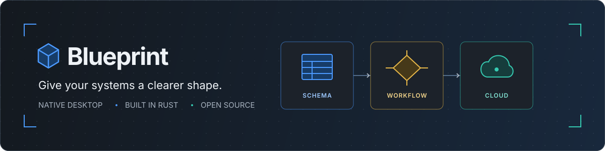
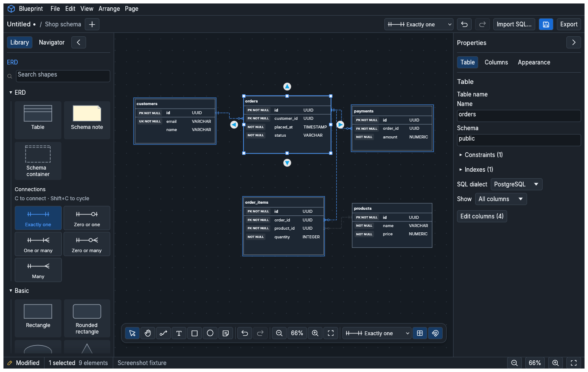
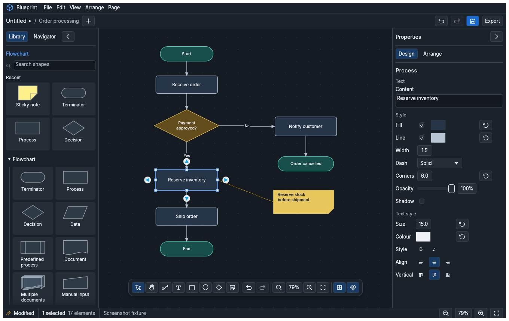
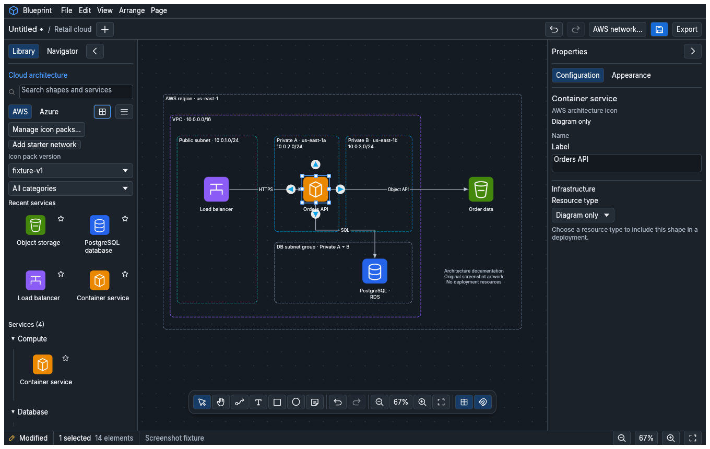

<p align="center">
  
</p>

<p align="center">
  <strong>A native desktop workspace for turning systems into clear diagrams.</strong><br>
  Entity relationships · Flowcharts · Cloud architecture
</p>

<p align="center">
  <a href="https://github.com/mauLanarhodes/blueprint/actions/workflows/ci.yml"></a>
  
  
  
</p>

<p align="center">
  <a href="#overview">Overview</a> ·
  <a href="#screenshots">Screenshots</a> ·
  <a href="#current-state">Current state</a> ·
  <a href="#run-blueprint">Run Blueprint</a> ·
  <a href="#project-goals">Goals</a> ·
  <a href="#contributing">Contribute</a>
</p>

---

## Overview

Blueprint is an open-source diagram editor written in **Rust** with a native
**egui/eframe** interface. Its goal is to bring database design, process mapping,
and cloud architecture into one responsive desktop workspace.

Draw and connect ideas, inspect their properties, and save editable local files.
The workspace adds typed ERD tables, PostgreSQL schema interchange,
searchable cloud artwork, and a floating drawing toolbar. A shared scene powers
the canvas and SVG export so diagrams can move from editing to documentation.

| Design schemas | Explain workflows | Map infrastructure |
| :--- | :--- | :--- |
| Typed tables, stable column connections, and Crow's Foot relationships. | Labeled shapes, routed connectors, annotations, and reusable groups. | AWS/Azure architecture artwork and an explicit, limited AWS deployment workflow. |

## Screenshots

These are **actual rendered application screens**, using populated example
documents. They were captured from `ui-changes`; that workspace is now merged
into `main`.

### ERD · Design the data model

A shop schema with typed columns, key badges, Crow's Foot relationships, and a
contextual table inspector.

[](docs/screenshots/erd.png)

### Flowchart · Make the process readable

An order-processing workflow with a payment decision, an inventory annotation,
shipment, and a cancellation path.

[](docs/screenshots/flowchart.png)

### Cloud architecture · Document the system

A sample network with labeled services, subnet boundaries, storage connectivity,
and a database subnet group. The icons in this example are **original synthetic
fixture artwork**; official AWS/Azure packs are imported separately.

[](docs/screenshots/cloud.png)

The cloud example is an architecture diagram. Its service icons do not imply
that those services can be deployed. See [AWS deployment](#aws-deployment).
Screenshot provenance and regeneration commands are in
[the gallery notes](docs/screenshots/README.md).

## Current state

**Blueprint is in active, pre-1.0 development.** The manifests currently declare
version `0.1.0`. The expanded ERD, flowchart, and cloud workspace is now merged
into **`main`**, including the redesigned UI and limited AWS network deployment.

Clone `main` using the instructions below to run the workspace shown in the
gallery. Builds are currently from source; packaged stable releases remain
future work.

### Available today

| Area | Implemented behavior |
| :--- | :--- |
| **Desktop UI** | Dark/Light themes, resizable and collapsible docks, Library/Navigator tabs, a floating toolbar, a page-add button, contextual inspectors, and persistent workspace preferences. |
| **Canvas editing** | Pan/zoom, selection and multiselection, snapping and guides, text editing, grouping, alignment, ordering, clipboard, locking, and undo/redo. |
| **Flowcharts** | Searchable labeled shape libraries, glued connectors, straight/orthogonal/curved routing, connector labels, and annotations. |
| **ERDs** | Smart tables, typed columns, key/nullability metadata, stable column ports, Crow's Foot relationships, constraints/indexes, column selection, relationship details, and automatic layout. |
| **SQL** | Preview-first **PostgreSQL** import/export through the UI and CLI. Other table dialects provide type suggestions; their SQL interchange is not implemented. |
| **Cloud diagrams** | Local official AWS/Azure SVG-pack imports, versioned catalogs, search, grid/list views, favorites/recents, editable labels, and embedded artwork in saved projects. |
| **AWS deployment** | Terraform preview and reviewed-plan application for explicitly configured **VPCs and private IPv4 subnets**. |
| **Files and export** | `.blueprint` archives, readable `.blueprint.json`, older-format migration, SVG export, and headless file/SQL commands. |

Presentation mode, a minimap, direct ERD cell editing and row dragging on the
canvas, automatic cloud containment, broader AWS services, and Azure deployment
remain future work. Windows, Linux, and macOS are included in the CI build/test
matrix; installers and platform-specific release packaging remain separate work.

## Run Blueprint

You need **Git**, **Rust 1.95 or newer**, and the native compiler tools for your
platform. The repository selects the `stable` Rust channel and requests
`rustfmt` and `clippy`. Update Rust if your installed stable toolchain is older.

<details>
<summary><strong>Windows · PowerShell</strong></summary>

1. Install [Git for Windows](https://git-scm.com/downloads/win).
2. Install Rust using [rustup](https://rust-lang.org/tools/install/). Use the
   default MSVC toolchain.
3. Install the [Visual Studio C++ Build Tools](https://visualstudio.microsoft.com/visual-cpp-build-tools/)
   with **Desktop development with C++**, the MSVC C++ toolset, and a Windows 10
   or Windows 11 SDK. See the [MSVC prerequisites](https://rust-lang.github.io/rustup/installation/windows-msvc.html).
4. Open a new PowerShell window, then run:

```powershell
rustup update stable
rustc --version
cargo --version
git clone https://github.com/mauLanarhodes/blueprint.git
cd blueprint
cargo run -p bp-app --release --locked
```

Open an existing project:

```powershell
cargo run -p bp-app --release --locked -- "C:\Users\you\Documents\plan.blueprint"
```

Build without launching:

```powershell
cargo build --release -p bp-app -p bp-cli --locked
.\target\release\blueprint.exe
# Or open a diagram directly; quote paths that contain spaces:
.\target\release\blueprint.exe "C:\Users\you\Documents\plan.blueprint"
```

Run Cargo commands from the repository root (the folder containing `Cargo.toml`).
If `cargo` or `rustc` is not recognized, reopen PowerShell and check that
`%USERPROFILE%\.cargo\bin` is on your user `PATH`. If `link.exe` is missing,
check that the C++ workload and Windows SDK above are installed.

</details>

<details>
<summary><strong>Linux · Debian / Ubuntu</strong></summary>

Install the compiler tools and windowing development libraries used by CI:

```sh
sudo apt-get update
sudo apt-get install -y build-essential pkg-config git curl \
  libxcb-render0-dev libxcb-shape0-dev libxcb-xfixes0-dev libxkbcommon-dev
```

Install Rust with the [official rustup installer](https://rust-lang.org/tools/install/),
then clone and run:

```sh
curl --proto '=https' --tlsv1.2 -sSf https://sh.rustup.rs | sh
. "$HOME/.cargo/env"
rustup update stable
git clone https://github.com/mauLanarhodes/blueprint.git
cd blueprint
cargo run -p bp-app --release --locked
```

Use a graphical desktop session. Other distributions need equivalent compiler
and XCB/XKB development packages.

```sh
# Open an existing project
cargo run -p bp-app --release --locked -- "$HOME/Documents/plan.blueprint"

# Build without launching, then run the binary
cargo build --release -p bp-app -p bp-cli --locked
./target/release/blueprint
```

</details>

<details>
<summary><strong>macOS · Terminal</strong></summary>

Install Apple's [Command Line Tools for Xcode](https://developer.apple.com/documentation/xcode/installing-the-command-line-tools/)
and complete the installer before continuing:

```sh
xcode-select --install
```

Install Rust with the [official rustup installer](https://rust-lang.org/tools/install/),
then clone and run. The Xcode command-line tools also provide Git.

```sh
curl --proto '=https' --tlsv1.2 -sSf https://sh.rustup.rs | sh
. "$HOME/.cargo/env"
rustup update stable
git clone https://github.com/mauLanarhodes/blueprint.git
cd blueprint
cargo run -p bp-app --release --locked
```

```sh
# Open an existing project
cargo run -p bp-app --release --locked -- "$HOME/Documents/plan.blueprint"

# Build without launching, then run the binary
cargo build --release -p bp-app -p bp-cli --locked
./target/release/blueprint
```

This builds a native executable from source; an application bundle and signed
macOS installer are not provided by these commands.

</details>

The first build downloads and compiles dependencies. Later launches can use the
built executable directly. To try the bundled ERD:

```sh
cargo run -p bp-app --release --locked -- examples/orders.blueprint.json
```

<details>
<summary><strong>Graphics troubleshooting</strong></summary>

Blueprint tries **WGPU**, then falls back to **OpenGL/Glow** if WGPU cannot start.
You can choose a renderer explicitly.

Linux/macOS:

```sh
BLUEPRINT_RENDERER=glow cargo run -p bp-app --release --locked
```

Windows PowerShell:

```powershell
$env:BLUEPRINT_RENDERER = "glow"
cargo run -p bp-app --release --locked
Remove-Item Env:BLUEPRINT_RENDERER
```

Use `wgpu` instead of `glow` to test the WGPU path.

</details>

## Your first diagram

Choose **ERD**, **Flowchart**, or **Cloud architecture** when
creating a document. Use the **+** beside the page name to add another page.

- **Library** inserts shapes and services; **Navigator** manages pages, layers,
  groups, and objects. Double-click a navigation entry to frame it.
- The floating toolbar holds drawing and connector tools. Select an element to
  edit it in **Properties**; double-click ordinary text to edit it on the canvas.
- On an ERD page, **Import SQL…** previews a PostgreSQL schema before importing
  editable tables and relationships. Column edits remain in the inspector.
- On a cloud page, **Manage icon packs…** guides local AWS/Azure ZIP import.
  Official vendor artwork is not bundled. **Add starter network** works without
  an installed pack.
- Save an editable `.blueprint` project, then export SVG for documentation.
  Workspace theme/layout preferences are stored separately from the document.

### AWS deployment

Blueprint deploys **two resource types: AWS VPCs and private IPv4
subnets**. EC2, ECS, Lambda, RDS, S3, and other service icons are diagram artwork
unless a supported resource configuration is explicitly assigned. Drawing a
boundary or connecting icons does not configure deployment dependencies.

With **Terraform 1.5+ in the 1.x series** on PATH and an authenticated local AWS
profile/session, create a starter network, open **AWS network…**, set the account,
region, and deployment folder, then preview. Review the actual saved Terraform
plan before choosing **Deploy reviewed plan**. Applying creates or changes real
AWS resources and can incur charges. Preserve the deployment folder: it holds
Terraform state outside the diagram.

Read the full [deployment setup and safeguards](docs/cloud-deployment.md)
before using this workflow. No AWS account or Terraform installation is required
for ordinary diagram editing.

## Project goals

Blueprint aims to become a dependable, open-source desktop workspace for
designing and communicating systems:

1. **One coherent editor.** Make ERD, flowchart, and cloud work feel consistent,
   with readable catalogs, contextual properties, accessible controls, and
   useful navigation at small and large window sizes.
2. **Reliable local documents.** Preserve authored artwork, connections, undo,
   and save/reopen behavior; keep project files portable and exports faithful.
3. **Semantic diagramming.** Build on typed ERD data and PostgreSQL interchange,
   then improve direct table editing, additional notations, and SQL dialects.
4. **Clear cloud modeling.** Add real boundary/containment behavior and improve
   provider catalogs without treating service artwork as deployable resources.
5. **Deliberate infrastructure deployment.** Expand supported AWS resources
   through validated configuration, explicit dependencies, real plan previews,
   and reviewed application. Broad AWS coverage is a long-term goal, not a
   current capability.
6. **A polished desktop product.** Improve large-document performance, recovery,
   presentation/navigation, and tested Windows/Linux/macOS distribution.

The next milestones include direct ERD cell editing, canvas row reordering,
presentation mode, a minimap, cloud containment, and broader infrastructure
support. Follow the development notes for
[editor work](docs/phase-1.md),
[ERDs](docs/phase-2.md), and
[cloud architecture](docs/phase-3.md).
Those phase notes also record earlier milestones; the current-state table above
reflects the newer workspace changes.

## CLI and project files

Inspect a project or export its first page as SVG:

```sh
cargo run -p bp-cli -- info plan.blueprint
cargo run -p bp-cli -- export plan.blueprint plan.svg
```

The CLI also offers page selection, embedded SVG fonts, and
PostgreSQL interchange:

```sh
cargo run -p bp-cli -- export plan.blueprint plan.svg --page 2 --embed-fonts
cargo run -p bp-cli -- import-sql schema.sql --preview
cargo run -p bp-cli -- import-sql schema.sql schema.blueprint
cargo run -p bp-cli -- export-sql schema.blueprint --dialect postgres --preview
cargo run -p bp-cli -- export-sql schema.blueprint schema-export.sql --page 1
```

| Format | Purpose |
| :--- | :--- |
| `.blueprint` | ZIP archive containing `document.json` and used cloud SVG artwork. |
| `.blueprint.json` | Readable JSON for reviewing document changes in Git. |
| `.svg` | Vector output for documentation and sharing. |
| `.sql` | PostgreSQL schema interchange, with preview warnings. |

Documents carry a `schema_version`, currently **6**. Blueprint migrates older
documents on open. Newer-format files require a build that supports their schema.

## Contributing

Contributions are welcome: bug reports, focused code changes, usability feedback,
documentation, sample diagrams, and testing on Windows, Linux, or macOS all help.

**Report a bug.** [Open an issue](https://github.com/mauLanarhodes/blueprint/issues/new)
with your branch/commit, OS, renderer, steps to reproduce, and expected behavior.
Include a minimal diagram or screenshot when possible; remove credentials and
private data from anything you share.

**Propose a feature.** Explain the workflow it improves and how it relates to the
project goals. Discuss larger model, file-format, or deployment changes in an
issue before implementing them.

**Send a pull request.** Fork the repository, start from an up-to-date `main`,
and create a focused topic branch. Open your PR against `main`.

```sh
git switch -c feat/describe-your-change
cargo run -p bp-app
```

Run the shared checks before submitting:

```sh
cargo fmt --all --check
cargo clippy --workspace --all-targets -- -D warnings
cargo test --workspace
```

For scene or performance work, also run:

```sh
cargo test --release -p bp-scene --test bench -- --nocapture
```

Explain what changed, why it helps, and how you verified it. Add regression tests
for behavior changes; include actual before/after renders for visual changes.
Preserve existing documents and undo transactions. Deployment tests should use
the existing mock runners and must not contact AWS.

### Where the code lives

The workspace has fourteen crates, separating the desktop interface from the
model, commands, geometry, persistence, and infrastructure integrations:

| Crates | Responsibility |
| :--- | :--- |
| `bp-app` | Native desktop UI and application orchestration. |
| `bp-model`, `bp-commands`, `bp-io` | Documents, validation, undoable edits, persistence, and migration. |
| `bp-geom`, `bp-scene`, `bp-render-egui`, `bp-export` | Geometry, shared scene construction, screen rendering, and SVG output. |
| `bp-cli` | Headless file commands and SQL interchange. |
| `bp-shapes`, `bp-text`, `bp-icons` | Shape libraries, bundled font measurement, and cloud artwork catalogs. |
| `bp-sql`, `bp-deploy` | PostgreSQL interchange and reviewed Terraform network deployment. |

Only `bp-app` and `bp-render-egui` depend on egui. Keep document and export logic
usable without a graphical session.

## License and artwork

The Cargo manifests declare **MIT OR Apache-2.0** for project code.
Blueprint bundles [Inter](https://rsms.me/inter/) under the
SIL Open Font License and uses [Phosphor](https://phosphoricons.com/) icons under
MIT. Official AWS/Azure artwork is imported locally under each provider's terms;
it is not distributed in this repository. The cloud screenshot uses original
synthetic artwork for reproducible examples.

---

<p align="center">
  <strong>Help shape Blueprint.</strong><br>
  <a href="https://github.com/mauLanarhodes/blueprint/issues">Report an issue</a> ·
  <a href="https://github.com/mauLanarhodes/blueprint/pulls">Browse pull requests</a> ·
  <a href="https://github.com/mauLanarhodes/blueprint/tree/main">Explore the source</a>
</p>
